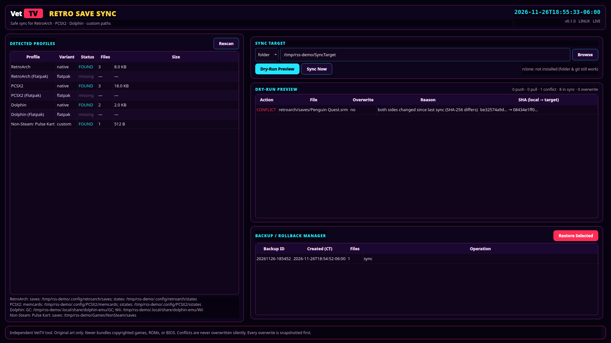

# VetTV Retro Save Sync

Safe, reversible save sync for **RetroArch**, **PCSX2**, **Dolphin**, and custom non-Steam save folders across **Linux, SteamOS (Desktop Mode), and Windows**.

**Website:** https://vettv-retro-save-sync.vercel.app



## Features
- Auto-detects RetroArch, PCSX2, and Dolphin save locations (native + Flatpak on Linux/SteamOS, `%APPDATA%` / `Documents` on Windows), plus any custom folders you add.
- Sync targets: a local/mounted folder (USB, NAS, Syncthing, Google Drive or OneDrive client folder), a **Git** repo, or any **rclone** remote.
- SHA-256 three-way conflict detection. It **never** silently overwrites a conflicting or independently changed save.
- Automatic timestamped rollback backup before every overwrite, with SHA-256-verified restore.
- Dry-run preview, a CLI, and a dark Qt 6 desktop GUI.

Never bundles games, ROMs, or BIOS files. Bring your own.

## Install and run (from source)
Requires Python 3.11+.

**CachyOS / Arch**
```sh
sudo pacman -S --needed python git
git clone https://github.com/VetTV-Studios/vettv-retro-save-sync && cd vettv-retro-save-sync
python -m venv .venv && source .venv/bin/activate   # fish: source .venv/bin/activate.fish
pip install -e ".[gui]"
retro-save-sync gui
```

**SteamOS (Desktop Mode) / other Linux**: same as above with your distro's Python 3.11+ (on SteamOS, keep the venv in your home folder).

**Windows (PowerShell)**
```powershell
git clone https://github.com/VetTV-Studios/vettv-retro-save-sync; cd vettv-retro-save-sync
py -m venv .venv; .venv\Scripts\activate
pip install -e ".[gui]"
retro-save-sync gui
```

## CLI
```sh
retro-save-sync scan                                   # detect emulators and save folders
retro-save-sync preview --target /mnt/saves --target-type folder
retro-save-sync sync --target /mnt/saves               # two-way, conflict-safe
retro-save-sync backups                                # list rollback snapshots
retro-save-sync restore 20261126-183000                # verified restore
retro-save-sync gui --demo                             # GUI with a safe demo dataset
```

## Builds
The [`build`](.github/workflows/build.yml) GitHub Actions workflow (manual run or `v*` tag) produces a Linux **AppImage** and a Windows **`.exe`** with PyInstaller ([`packaging/retro-save-sync.spec`](packaging/retro-save-sync.spec)).

## Tests
```sh
pip install -e ".[dev]"
pytest
```

See [`PLAN.md`](PLAN.md) for architecture and path maps. The marketing/docs site lives in [`site/`](site/).

---
Made by [VetTV Studios](https://vettvstudios.com). Not affiliated with RetroArch/Libretro, PCSX2, or Dolphin.
